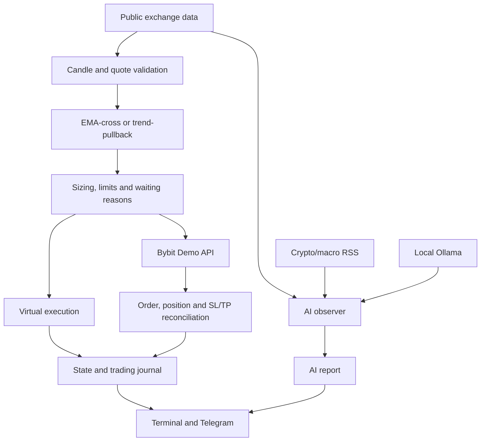

# TradeBot 0.2 — complete user and operator manual

[Русское руководство](MANUAL.ru.md) · [Home](../README.md) · [New-version quick start](REWORK.en.md)

This manual describes the implemented version 0.2.0. The main example uses a Mac, VS Code, Python 3.12, BTC/USDT perpetual on Bybit Demo, and local Ollama. Commands assume `~/Downloads/TradeBot-git`. If your checkout is elsewhere, change the directory path, not the Python module names.

## Contents

1. [Purpose and limits](#scope)
2. [System architecture](#architecture)
3. [Prepare your Mac and terminal](#prepare)
4. [First download and installation](#install)
5. [Move from ZIP and update](#update)
6. [First run without credentials](#paper)
7. [Bybit Demo: account, permissions, IP and keys](#bybit)
8. [Telegram: creation, chat ID and connection](#telegram)
9. [Ollama: installation, model and checks](#ollama)
10. [Unified startup and a separate advisor](#launch)
11. [Daily startup and shutdown](#daily)
12. [Modes and strategies](#strategies)
13. [Risk, allocation, costs and sizing example](#risk)
14. [Complete command reference](#cli)
15. [Environment variables and Keychain](#environment)
16. [Output, journals and monitoring](#monitoring)
17. [Explicit entry/exit test](#smoke)
18. [Backtesting and policy comparison](#benchmark)
19. [State, locks and recovery](#recovery)
20. [Troubleshooting](#troubleshooting)
21. [Collecting data and evaluating results](#evaluation)
22. [Source map and further development](#development)

<a id="scope"></a>
## 1. Purpose and limits

TradeBot is an experimental project for researching trading rules, virtual execution and Bybit Demo. It supports public Binance/Bybit data, two deterministic strategies and a separate AI observer. Real-money trading is not implemented.

| Feature | Behavior |
|---|---|
| Historical backtest | Calculates results from closed OHLCV; no orders |
| Realtime paper | Maintains a virtual position using current public data |
| Bybit Demo | Sends actual API orders exclusively to Demo Trading |
| AI | Locally analyzes chart features and selected headlines; no trading tools |
| Telegram | Sends notifications; no trade-control commands |

Profitability has not been established. Passing unit tests, completing a Demo roundtrip, or receiving a confident model answer does not establish a trading edge. Synthetic results and verification limits are recorded in [VALIDATION.md](VALIDATION.md).

The AI does not train itself, update model weights, override risk limits, or determine orders. Its `confidence` is a subjective model assessment, not the probability of a profitable trade.

<a id="architecture"></a>
## 2. System architecture



With `--with-ai`, one command owns two Python processes: a fast trading loop and a slower observer. Ollama is a separate application/server that must already be running. BYBIT_* and TELEGRAM_* variables are removed from the observer subprocess environment.

JSON roles:

- `session`: selected mode and strategy at startup;
- `trader`: market checks, decisions and execution events;
- `advisor`: model reports; this process does not trade.

Seeing only `advisor` reports does not establish that the trader is running.

<a id="prepare"></a>
## 3. Prepare your Mac and terminal

Install [VS Code](https://code.visualstudio.com/), [Python 3.12 for macOS](https://www.python.org/downloads/macos/) and Git. AI additionally needs [Ollama](https://ollama.com/download/mac); check its current macOS requirements. The project requires Python 3.11 or newer.

Open Terminal or **VS Code → Terminal → New Terminal**:

```bash
python3.12 --version
git --version
sw_vers -productVersion
uname -m
```

The last two commands identify macOS and architecture: `arm64` or `x86_64`. An Intel Mac may generate model responses much more slowly. Rosetta and native terminal sessions can use different executables/environments.

Copy only commands, without the prompt `(.venv) ➜ ...`, `$`, or error messages. Use straight ASCII quotes `'`/`"`, not typographic `‘’`.

If VS Code opens without files: **File → Open Folder**, then select the project folder itself. If Explorer views are missing: Cmd+Shift+P → `View: Reset View Locations`, then Cmd+Shift+E.

<a id="install"></a>
## 4. First download and installation

Do this once. If a Git checkout already exists, use the update section instead.

```bash
cd ~/Downloads
git clone https://github.com/DownSh1fter/TradeBot.git TradeBot-git
cd ~/Downloads/TradeBot-git
pwd
ls pyproject.toml
```

`pwd` must end in `TradeBot-git`, and `ls` must find the file. Installing from `~/Downloads` will fail.

```bash
python3.12 -m venv .venv
source .venv/bin/activate
python --version
python -m pip install --upgrade pip
python -m pip install --only-binary=cryptography -e .
python -m unittest discover -s tests -v
```

`-e .` installs the current project in editable mode; the dot is required. Activation usually adds `(.venv)` to the prompt. Tests must execute a nonzero number of cases and finish with `OK`.

`--only-binary=cryptography` prevents a local Rust/maturin build of that dependency. If no compatible wheel exists, investigate Python/macOS/architecture compatibility rather than disabling TLS checks or changing dependency versions at random.

In VS Code choose **File → Open Folder → Downloads → TradeBot-git**. Use Cmd+Shift+P → `Python: Select Interpreter` → `.venv/bin/python`. Selecting the editor interpreter does not replace activation in an existing terminal.

### Every new terminal tab

```bash
cd ~/Downloads/TradeBot-git
source .venv/bin/activate
```

Activation does not load credentials. Variables set in another tab may be absent. The application does not automatically read `.env`.

<a id="update"></a>
## 5. Move from ZIP and update

A ZIP directory such as `TradeBot-main` is not a normal Git checkout. Clone into `TradeBot-git` to use `git pull`. Stop old processes first, reconcile exchange positions/orders and preserve the old directory.

If the new checkout does not yet contain `reports`, copy the old journals:

```bash
cp -R ~/Downloads/TradeBot-main/reports ~/Downloads/TradeBot-git/
```

Skip this if there is no old reports directory. If both directories contain reports, compare and back them up first; do not merge blindly. Do not copy `.venv` between locations. Preserve local source changes separately.

Update a Git checkout with both trader and advisor stopped:

```bash
cd ~/Downloads/TradeBot-git
git status --short
git pull --ff-only
source .venv/bin/activate
python -m pip install --only-binary=cryptography -e .
python -m unittest discover -s tests -v
```

If there are conflicts/local changes, preserve them before continuing. Do not use `git reset --hard`, `git clean`, or state/report deletion as a troubleshooting shortcut. Reports are ignored by Git: they are neither uploaded nor restored by cloning.

Before changing strategies, reconcile the old position. Start `trend-pullback` with a flat account and a separate state, then resume that same state on later runs. Preserve the previous strategy's file.

<a id="paper"></a>
## 6. First run without credentials

Disable Telegram if you are not configuring it yet:

```bash
unset TELEGRAM_BOT_TOKEN TELEGRAM_CHAT_ID
```

Run one paper iteration:

```bash
python -m dual_futures_bot --exchange bybit --mode realtime-paper --strategy trend-pullback --timeframe 15m --limit 200 --equity 1000 --fee-rate 0.00055 --cycles 1 --state reports/paper-trend.json
```

No exchange order is created. Expect `role: session`, then `role: trader` and a `decision`. Empty `events` are normal. `--cycles 1` counts a polling attempt; a skipped quote attempt completing does not establish a successful market check.

Remove `--cycles 1` for continuous virtual trading. This checks public data and strategy operation, not Demo API permissions or actual fills.

<a id="bybit"></a>
## 7. Bybit Demo: account, permissions, IP and keys

### Prepare the account in Bybit

1. Sign in and switch to **Demo Trading**. This differs from Testnet and the main trading account.
2. Find **API management** within Demo and create a system-generated key.
3. Enable contract reading and trading permissions: **Read-Write / Orders**. Withdrawal permission is unnecessary.
4. Save the API Key and API Secret. The secret may only be shown during creation. Replace the key if the secret cannot be recovered; a Key cannot be converted into its Secret.
5. Use **one-way** position mode for a linear USDT perpetual. Configure margin/leverage in Demo and verify the virtual USDT balance. The bot does not change these settings.
6. If IP restrictions are enabled, bind the current external address of your connection/VPN. A local `192.168...` address is unsuitable. Changing networks/VPN can change the external IP.

Bybit UI labels may change. Demo API responses establish whether a key works. Use a dedicated account/symbol without other bots or manual trading.

### Enter the API Key separately from the command

In the terminal tab that will run trading, execute **only this line**:

```bash
read -r -s BYBIT_DEMO_API_KEY
```

The terminal now waits silently. Paste **only the API Key value** with Cmd+V, then press Enter. Characters and asterisks are not displayed; this is hidden input. Next:

```bash
export BYBIT_DEMO_API_KEY
echo
```

For the Secret:

```bash
read -r -s BYBIT_DEMO_API_SECRET
```

Paste the Secret, press Enter, then:

```bash
export BYBIT_DEMO_API_SECRET
echo
```

These commands work in bash and zsh. Do NOT replace the variable name with the key. Do not paste subsequent command blocks while `read` is waiting. The hidden value needs no surrounding quotes.

### Check presence and format without revealing values

```bash
python - <<'PY'
import os
for name in ('BYBIT_DEMO_API_KEY', 'BYBIT_DEMO_API_SECRET'):
    value = os.environ.get(name, '')
    ok = bool(value) and value.isascii() and not any(c.isspace() for c in value)
    print(name, 'format OK' if ok else 'missing or invalid characters')
PY
```

Format OK does not verify API authentication/permissions. Do not print values with echo/printenv or send credentials in chat. Revoke and replace any credential exposed in a message or screenshot.

<a id="telegram"></a>
## 8. Telegram: setup and connection test

1. Open the verified **@BotFather**, send `/newbot`, choose a name/username and obtain a token.
2. Open your new bot and press **Start** or send `/start`. Otherwise it may be unable to message you.
3. For a private chat, obtain your numeric `Id` from **@userinfobot**. It does not need your bot token. This is neither a phone number nor an @username. Groups need their own chat ID and sending permissions; group members will see account information.

In your trading tab:

```bash
read -r -s TELEGRAM_BOT_TOKEN
```

Paste the token and press Enter. Once the prompt returns:

```bash
export TELEGRAM_BOT_TOKEN
echo
```

Enter the chat ID visibly:

```bash
read -r TELEGRAM_CHAT_ID
```

Type only the number, press Enter, then:

```bash
export TELEGRAM_CHAT_ID
export TELEGRAM_STATUS_SECONDS='300'
```

Test without placing orders:

```bash
python - <<'PY'
import os
from dual_futures_bot.telegram import Telegram
if not os.environ.get('TELEGRAM_BOT_TOKEN') or not os.environ.get('TELEGRAM_CHAT_ID'):
    print('Token or chat ID is empty')
else:
    notifier = Telegram.from_env()
    try:
        ok = notifier.send('Connection test', {'message': 'TradeBot connected; no orders sent'})
        print('Sent' if ok else 'Delivery failed')
    finally:
        notifier.close()
PY
```

Notifications include startup/shutdown/errors, order events, position snapshot changes and periodic market/decision/AI summaries. Summary interval defaults to 300 seconds, minimum 30. There are no Telegram buy/sell commands.

Sending is synchronous with short timeouts. A delivery failure does not repeat a trading order, but a message can be lost; there is no delivery queue. Messages are capped at 4000 characters and may be truncated. Reconcile using journals and Bybit. A position opening and closing entirely between polls may be missed by position notifications.

Disable BOTH variables to turn Telegram off:

```bash
unset TELEGRAM_BOT_TOKEN TELEGRAM_CHAT_ID
```

Providing only one is a configuration error.

<a id="ollama"></a>
## 9. Ollama and the model

Install the app into Applications and open it. Check:

```bash
ollama --version
ollama list
```

If the CLI cannot be found, use its full path:

```bash
/Applications/Ollama.app/Contents/Resources/ollama --version
```

If the app is not serving requests, use another tab:

```bash
/Applications/Ollama.app/Contents/Resources/ollama serve
```

Do not start a second server on an occupied port. Keep the server running. Download the model once from a different tab:

```bash
/Applications/Ollama.app/Contents/Resources/ollama pull qwen2.5:3b
```

No cloud model API key is required. The model needs disk, RAM and compute; 3b is not a RAM specification. A slower Mac can try `qwen2.5:1.5b`, a more powerful one `qwen2.5:7b`, after downloading and selecting the exact tag. Smaller models may reason less well or fail the required format more often.

Test the observer separately, without trading:

```bash
python -m dual_futures_bot.ai_advisor --exchange bybit --timeframe 15m --cycles 1 --timeout 480 --max-tokens 512
```

`loading public market data`, `loading news feeds` and `waiting for Ollama` are progress messages. Final `status: ok` means a valid response; `status: error` requires inspecting `error_type` and `hint`. Increasing `n_gen` in Ollama logs means generation is progressing. Cancellation around two minutes can reflect an older client timeout: update the checkout and use 480 seconds.

The observer receives the selected timeframe plus 1h features, EMA/ATR, 1/4/16-bar returns, relative volume and up to 20 selected crypto/macro headlines from the previous 24 hours. Up to three HTTPS redirects are accepted; downgrade to HTTP is rejected. Feed failures are exposed in `news_coverage`; a valid model response does not mean every source loaded. News text is untrusted data, not executable instructions. This is not a complete economic calendar, full-article reader or entire-web stream.

<a id="launch"></a>
## 10. Unified startup and a separate advisor

### Option A: recommended simple arrangement

Run Ollama and one TradeBot command. Stop an older separately running advisor first.

Paper with an owned AI observer:

```bash
python -m dual_futures_bot --exchange bybit --mode realtime-paper --strategy trend-pullback --timeframe 15m --limit 200 --equity 1000 --fee-rate 0.00055 --with-ai --state reports/paper-trend.json
```

Demo with an owned observer, only after loading credentials and reconciling previous positions/orders:

```bash
python -m dual_futures_bot --exchange bybit --mode bybit-demo --strategy trend-pullback --timeframe 15m --limit 200 --equity 1000 --fee-rate 0.00055 --with-ai --state reports/demo-trend.json
```

The second command can submit Demo orders. Verify the mode. Advisor output goes to `reports/ai-advisor.log`; its history is `reports/ai-advisor.history.jsonl`. The trader remains in your terminal. Omit `--with-ai` to run without AI.

Inspect child progress from another tab:

```bash
tail -n 20 reports/ai-advisor.log
```

### Option B: separate processes

Use the Ollama app/server, a second tab for the advisor, and a third for the trader. Activate `.venv` independently in tabs two and three.

Advisor:

```bash
python -m dual_futures_bot.ai_advisor --exchange bybit --timeframe 15m --interval 60 --timeout 480 --max-tokens 512
```

Trader:

```bash
python -m dual_futures_bot --exchange bybit --mode bybit-demo --strategy trend-pullback --timeframe 15m --limit 200 --equity 1000 --fee-rate 0.00055 --ai-report reports/ai-advisor.json --state reports/demo-trend.json
```

Do NOT add `--with-ai` here: it would conflict with the existing observer. Standalone history defaults to `reports/ai-history.jsonl`, while managed-child history is `reports/ai-advisor.history.jsonl`.

If you change symbol/timeframe/report, match them between trader and observer. Do not share a report/state between different markets.

<a id="daily"></a>
## 11. Daily operation

Startup order: open the correct directory → activate the environment → load credentials/Telegram in the trading tab → reconcile Demo positions/orders → start Ollama if needed → start one trader with its previous state and parameters.

The Mac needs network access and must remain awake. The built-in macOS wrapper can prevent automatic idle sleep while the command runs:

```bash
caffeinate -i python -m dual_futures_bot --exchange bybit --mode bybit-demo --strategy trend-pullback --limit 200 --equity 1000 --fee-rate 0.00055 --with-ai --state reports/demo-trend.json
```

This does not guarantee operation with the lid closed, during shutdown, network loss or terminal closure. It is not a hosted service.

Stop with Ctrl+C in the trader terminal. Its owned advisor stops too; a separately launched advisor does not. Ollama remains a separate application. **Stopping the process does not close exchange positions or cancel exchange orders.** Accepted exchange SL/TP orders may remain active; check them in Bybit.

After a crash/sleep/disconnection, reconcile exchange state and pending_order before restarting. Changed credentials/network/IP may require configuration updates. Reload variables in a new tab; Ctrl+C in the original tab does not itself clear them.

<a id="strategies"></a>
## 12. Strategies and trade frequency

### EMA-cross: legacy default

EMA20 crossing above EMA50 on a closed candle signals long; crossing below signals short. Online evaluation uses the latest closed candle; downtime does not replay missed signals. Stop is 2 ATR, with paper trailing; Demo does not automatically trail its initial stop. A fresh crossover may not occur for hours.

### Trend-pullback-v1: select explicitly

`--strategy trend-pullback` enables the [documented policy](REWORK.en.md): EMA gap of at least 0.25 ATR, matching EMA20 slope over three candles, acceptable volatility and volume, contact with the EMA20 zone within three candles, rebound confirmation and sufficient target distance relative to costs. Online checks additionally require spread no greater than 0.08% and a current price within one ATR of the signal close.

Stop Loss is 2 ATR, Take Profit 3 ATR, with exits on EMA regime reversal or 24-bar holding time. Cooldown after exit is three candles. There is no trailing for this policy. At 15m, 24 bars correspond to six hours and cooldown to 45 minutes; these durations do not guarantee timely exits while a process is stopped or broken.

Neither strategy opens a position merely because 30 minutes or two hours passed. A shorter timeframe increases noise and costs without necessarily improving returns. Do not switch it under the same state mid-run. AI neutral does not block a trade; bullish does not trigger one.

<a id="risk"></a>
## 13. Risk, allocation and costs

`--equity 1000` sets the sizing allocation. It does not buy 1000 USDT every time or guarantee a maximum loss. The new policy sizes against the smaller of observed equity and initial allocation.

| Constraint | Current value | Defined in |
|---|---|---|
| Per-trade risk | 0.0025 = 0.25% | `RiskConfig.risk_fraction` |
| Maximum notional | 0.25 = 25% of base | `RiskConfig.max_notional_fraction` |
| Daily loss budget | 0.01 = 1% of base | `RiskConfig.max_daily_loss_fraction` |
| Initial stop | 2 ATR | `RiskConfig.stop_atr_multiple` |
| Trend target | 3 ATR | `policy.py` |
| Trend maximum holding | 24 bars | `policy.py` |
| Trend cooldown | 3 bars | `policy.py` |

Of these settings, CLI exposes allocation and assumed costs. There are NO `--risk`, `--leverage`, `--stop`, `--take-profit` or `--live` flags. Other changes require code changes, tests and state reconciliation.

Approximate trend sizing:

```text
base = min(observed_equity, configured_equity)
risk_money = base × 0.0025
unit_budget = abs(reference_price - rounded_stop) + reference_price × 2 × (fee_rate + slippage_rate)
base_quantity = min(risk_money / unit_budget, base × 0.25 / reference_price)
contracts = round_down(base_quantity / contractSize)
```

Example: base 1000, price 80000, ATR 150, stop distance 300, fee 0.00055 and slippage 0.0002 per side. Risk budget is 2.5 USDT; unit cost allowance is 120. Risk sizing gives about 0.00595 BTC; notional sizing caps this at 0.003125 BTC. With contractSize 1 and step 0.001, size becomes 0.003 BTC, about 240 USDT. This is arithmetic, not a prescribed size or fill guarantee.

If size falls below exchange minimums, the bot waits rather than increasing risk. The new Demo policy also caps notional by free USDT; it neither increases size through leverage nor changes leverage via API.

For trend, the daily budget is 1% of the smaller of observed UTC-day starting equity and configured equity. An allocation of 1000 with a 100000 Demo balance gives a 10 USDT daily budget. Demo prefers Bybit's USDT coin equity, otherwise wallet plus selected-position unrealized PnL. Paper/backtest use accounted balances/results rather than a full exchange margin model. Legacy uses observed day-start capital without the new allocation cap. A dedicated account matters: other trades/deposits/positions distort the control.

The daily limit blocks new entries, not protective exits, and does not guarantee a loss ceiling: gaps, fees, funding, liquidation and failures can exceed it. Funding is absent from the cost filter and backtest, although actual exchange equity changes may include it.

Examples use fee 0.00055 as an assumption, not a claim about your Bybit fee tier. Set costs realistically for your account. Slippage is also an assumption, not a controlled execution price.

<a id="cli"></a>
## 14. Complete command reference

Help does not place orders:

```bash
python -m dual_futures_bot --help
python -m dual_futures_bot.ai_advisor --help
python -m dual_futures_bot.demo_smoke --help
python -m dual_futures_bot.benchmark --help
```

### Main module

| Flag | Default | Meaning/constraint |
|---|---|---|
| `--exchange` | required | binance/bybit; Demo requires bybit |
| `--mode` | backtest | backtest/realtime-paper/bybit-demo |
| `--strategy` | ema-cross | ema-cross/trend-pullback |
| `--symbol` | BTC/USDT:USDT | CCXT unified symbol, not BTCUSDT; online linear USDT swap |
| `--timeframe` | 15m | Exchange-supported interval |
| `--limit` | 1000 | 60–1500 requested candles; actual response may contain fewer |
| `--equity` | 10000 | Positive finite number |
| `--poll-seconds` | 10 | At least 1, online |
| `--cycles` | 0 | 0 runs continuously; otherwise polling attempts including skips |
| `--state` | reports/realtime-state.json | Online state; choose an explicit separate path |
| `--ai-report` | absent | Reads an observer report; no signal influence |
| `--with-ai` | off | Starts an owned observer; unavailable for backtest |
| `--ai-model` | qwen2.5:3b | Child observer model |
| `--ai-timeout` | 480 | 30–540 seconds |
| `--ai-interval` | 60 | Delay after analysis, at least 60 seconds |
| `--ai-max-tokens` | 512 | 256–2048 output tokens |
| `--fee-rate` | 0.0005 | Assumed fee per side; not fetched from your fee tier |
| `--slippage-rate` | 0.0002 | Assumed adverse slippage per side |
| `--candles-json` | absent | Backtest only: OHLCV JSON array instead of fetching |

With `--with-ai` and no report path, the path becomes `reports/ai-advisor.json`. The main CLI validates AI budgets even when AI is disabled. At least 60 closed candles must remain after removing an unfinished one; requesting 60 can leave only 59, so examples request 200.

### Standalone ai_advisor

| Flag | Default | Notes |
|---|---|---|
| `--exchange` | bybit | bybit/binance |
| `--symbol` | BTC/USDT:USDT | Match trader |
| `--timeframe` | 15m | Also analyzes 1h |
| `--model` | qwen2.5:3b | Exact downloaded tag |
| `--timeout` | 300 | 30–540; differs from managed default 480 |
| `--max-tokens` | 512 | 256–2048 |
| `--feed` | BBC World + CoinDesk | Repeatable HTTPS RSS/Atom URL, at most 5; replaces defaults |
| `--report` | reports/ai-advisor.json | Latest report |
| `--history` | reports/ai-history.jsonl | Standalone history |
| `--interval` | 300 | Delay after completion, minimum 60 |
| `--cycles` | 0 | Analysis count; 0 runs continuously |

Use standalone mode for custom `--feed` sources. The main `--with-ai` command has no feed-forwarding option.

### demo_smoke

`--symbol` defaults to BTC/USDT:USDT; `--max-notional` defaults to 250 with range (0,250]; `--execute` explicitly enables Demo entry/exit; `--journal` defaults to reports/demo-smoke.json. The exchange is always Bybit Demo.

### benchmark

`--input` is a required OHLCV JSON file; `--output` defaults to reports/benchmark.json; `--equity` defaults to 1000; `--fee-rate` to 0.0005; `--slippage-rate` to 0.0002. Requires at least 240 candles. No `--with-ai` or orders.

<a id="environment"></a>
## 15. Environment variables and optional persistent storage

| Variable | Used by | Type |
|---|---|---|
| BYBIT_DEMO_API_KEY | Demo trader/smoke | Secret |
| BYBIT_DEMO_API_SECRET | Demo trader/smoke | Secret used for local HMAC signing |
| TELEGRAM_BOT_TOKEN | Trader with notifications | Secret |
| TELEGRAM_CHAT_ID | Trader with notifications | Numeric ID; sensitive chat metadata |
| TELEGRAM_STATUS_SECONDS | Telegram | Optional, default 300, minimum 30 |

Paper, backtest and AI need no Bybit keys. Setting a shell variable without `export` does not make it available to Python. Environment activation does not read `.env`, Keychain or another terminal's variables.

### Optional Mac Keychain

To avoid pasting secrets every time, manually create generic password items in **Keychain Access** with account `tradebot` and names `TradeBot-Bybit-Demo-Key`, `TradeBot-Bybit-Demo-Secret`, `TradeBot-Telegram-Token`. Store the corresponding secret in each password field. This is an OS configuration, not a built-in bot wizard; the UI varies by macOS version.

Load values into the current shell; macOS may request Keychain access:

```bash
BYBIT_DEMO_API_KEY="$(security find-generic-password -a tradebot -s TradeBot-Bybit-Demo-Key -w)" && export BYBIT_DEMO_API_KEY
BYBIT_DEMO_API_SECRET="$(security find-generic-password -a tradebot -s TradeBot-Bybit-Demo-Secret -w)" && export BYBIT_DEMO_API_SECRET
TELEGRAM_BOT_TOKEN="$(security find-generic-password -a tradebot -s TradeBot-Telegram-Token -w)" && export TELEGRAM_BOT_TOKEN
```

Enter chat ID with `read` as above. Values are not typed into command text: history contains Keychain lookup commands, not substituted secrets. Do not add echo. This requires existing items and an accessible Keychain; fall back to hidden read if lookup fails. These Mac-specific commands are documented for local use and were not executed in the cloud.

Clear the current tab:

```bash
unset BYBIT_DEMO_API_KEY BYBIT_DEMO_API_SECRET TELEGRAM_BOT_TOKEN TELEGRAM_CHAT_ID
```

This does not revoke Bybit keys or the Telegram token; revoke through the respective service. Secrets still enter shell/trader memory. Keychain does not hide a running process's environment from the computer's owner.

<a id="monitoring"></a>
## 16. Output and journals

| Field | Meaning |
|---|---|
| role | session/trader/advisor; identify the process first |
| analysis.signal | long/short/null technical signal |
| analysis.signal_reason | Strategy check on the latest closed candle |
| decision.action | wait/hold/enter/exit |
| decision.reason | Actual decision after state/exchange constraints |
| events | New events in this iteration |
| equity | Virtual balance or observed Demo equity |
| positions | Paper position or Demo position snapshot |
| analysis.quote_source | ticker_last/orderbook_midpoint |
| analysis.quote_age_seconds | Age relative to local time; small negative values are possible |
| analysis.ai_advisor | Separate model opinion, not an order |

Waiting reasons include `awaiting_ema_cross`, `awaiting_next_closed_candle`, `weak_trend`, `trend_slope_conflict`, `low_volume`, `low_volatility`, `high_volatility`, `price_too_far_from_ema`, `no_recent_pullback`, `rebound_not_confirmed`, `target_too_small_for_costs`, `spread_too_wide`, `spread_unavailable`, `entry_price_moved`, `post_exit_cooldown`, `daily_loss_limit`, `below_exchange_minimum`, `above_exchange_maximum`, `insufficient_free_balance_without_leverage`, `rounded_size_exceeds_risk`, `quote_expired_before_order` and `position_open`. Invalid contract/rounding metadata produces specific `invalid_*` reasons.

A long signal can still produce wait due to a limit, exchange minimum or already processed candle. Inspect both fields. After a paper exit, decision can already show wait/cooldown while events contains the exit.

For Demo, order `status: closed` means a completed order, not necessarily a closed position. Confirm a reduce-only exit and absence of the position in Bybit. `position_closed_observed` means the position disappeared between polls; it does not establish the cause, exit price or realized PnL.

### Paths used by the recommended commands

| File | Purpose |
|---|---|
| reports/demo-trend.json | Latest Demo state |
| reports/demo-trend.jsonl | Accepted cycles and rejected quotes |
| reports/demo-trend.json.lock | State lock |
| reports/.execution_bybit_BTC_USDT_USDT.lock | Shared local Demo execution lock |
| reports/ai-advisor.json | Latest AI report |
| reports/ai-advisor.json.lock | Observer lock |
| reports/ai-advisor.log | Managed observer output |
| reports/ai-advisor.history.jsonl | Managed observer history |
| reports/ai-history.jsonl | Standalone observer's default history |

State is the last known snapshot, not the current exchange truth. It stops updating during downtime. Audit is not a complete exchange fills/funding ledger.

Read recent records:

```bash
tail -n 3 reports/demo-trend.jsonl
tail -n 20 reports/ai-advisor.log
ls -la reports
```

Compact diagnostics without secret values:

```bash
python - <<'PY'
import json
import time
from pathlib import Path
for name in ('reports/demo-trend.json', 'reports/ai-advisor.json'):
    path = Path(name)
    if not path.exists():
        print(name, 'missing')
        continue
    row = json.loads(path.read_text())
    print(name, 'status=', row.get('status'), 'decision=', row.get('decision'))
    print('pending_order=', bool(row.get('pending_order')), 'error_type=', row.get('error_type'), 'hint=', row.get('hint'))
    if row.get('data_at') is not None:
        print('AI input age, seconds=', round((time.time()*1000-row['data_at'])/1000, 1))
PY
```

AI reports are accepted only for a matching market/schema and input age up to ten minutes. Age is measured from the input snapshot, not generation completion. A slow response can already be stale. Trading continues independently; `unavailable_or_stale` describes observer availability, not a trading halt.

Capture terminal output while preserving the command's failure status:

```bash
set -o pipefail
python -m dual_futures_bot --exchange bybit --mode realtime-paper --strategy trend-pullback --limit 200 --equity 1000 --fee-rate 0.00055 --state reports/paper-trend.json 2>&1 | tee -a reports/session.log
```

This starts a separate paper process; do not run it alongside an existing owner of that state. The reports directory must already exist. Logs have no rotation; archive them with processes stopped. They contain financial details and news text; inspect before sharing.

<a id="smoke"></a>
## 17. Explicit entry/exit test

Only with all strategies/other tests stopped and no position/orders for this symbol in Bybit Demo:

```bash
python -m dual_futures_bot.demo_smoke --execute --max-notional 250
```

This submits one market long with a protective stop, then a reduce-only market exit, without waiting for a chart signal. Reference notional is capped by the smaller of 250 and 25% of free USDT; actual execution cost may differ. It checks API execution, not profitability. It uses neither Telegram nor AI and must not run alongside the strategy.

Success:

```text
DEMO ROUNDTRIP OK: no position and no open orders for this symbol.
```

`reports/demo-smoke.json` is a single-use journal. If it exists, do not delete it to retry. Inspect the journal and reconcile Bybit first. Only after confirming completion and absence of a position may you choose another `--journal` name. See the [smoke guide](DEMO_SMOKE.en.md).

<a id="benchmark"></a>
## 18. Historical validation

A quick backtest fetches public closed candles and needs no keys:

```bash
python -m dual_futures_bot --exchange bybit --mode backtest --strategy trend-pullback --timeframe 15m --limit 1000 --equity 1000 --fee-rate 0.00055
```

The report filename contains exchange/symbol/timeframe. Repeating that combination, even with another strategy, overwrites the report. Preserve a copy or use the comparative benchmark.

Compare both policies on one fixed dataset:

```bash
python - <<'PY'
import json
from pathlib import Path
from dual_futures_bot.market_data import fetch_candles
path = Path('reports/BTCUSDT-15m-sample.json')
if path.exists():
    raise SystemExit('Dataset exists: preserve it or choose another name')
rows = fetch_candles('bybit', 'BTC/USDT:USDT', '15m', 1000)
path.parent.mkdir(parents=True, exist_ok=True)
path.write_text(json.dumps([[c.timestamp, c.open, c.high, c.low, c.close, c.volume] for c in rows]))
print('Saved closed candles:', len(rows))
PY
python -m dual_futures_bot.benchmark --input reports/BTCUSDT-15m-sample.json --output reports/benchmark.json --equity 1000 --fee-rate 0.00055 --slippage-rate 0.0002
```

Input is a JSON array of rows `[timestamp_ms, open, high, low, close, volume]`, with no text headers. Timestamp is the candle open in Unix milliseconds; prices must be positive, volume nonnegative, all values finite, time strictly increasing with continuous uniform intervals. Do not fill missing bars with fabricated trades. Benchmark requires at least 240 candles; simulate requires 60.

Benchmark records SHA256 and compares the first two-thirds and final third, using up to 200 preceding bars for indicator warmup without trading during warmup. It neither fits parameters nor automatically selects a winner. This is not a complete parameter-fitting walk-forward system.

`net_pnl` is modeled net performance; `fees_paid` is fees; `win_rate` is a fraction, not a percentage. `max_drawdown_fraction` uses realized equity; `max_mark_to_market_drawdown_fraction` marks positions at bar closes, not worst intrabar prices. If both SL and TP are touched in one OHLC bar, the engine assumes the stop first. It closes any remaining position at the last bar for reporting.

Historical execution omits funding/liquidation, actual order books and exchange quantity minimums/steps. Online constraints and indicator warmup cause differences. A short period or attractive PnL does not establish future returns.

<a id="recovery"></a>
## 19. State, locks and recovery

### State identity

Identity includes exchange, symbol, timeframe, paper/Demo mode and RiskConfig values; the new policy also includes `trend-pullback-v1`. Changing equity, costs or strategy can produce a mismatch. Resume with the original parameters and path.

Do not create a new state to bypass an unmanaged position, pending_order or parameter mismatch. Reconcile the exchange and preserve history; use a new state only for a deliberate, clean experiment. Paper positions persist too; deleting their state breaks simulation continuity.

### Unknown order outcome

1. Stop processes. Do not repeat a submission or run smoke.
2. Read state and pending_order/client_id. Back up state/journals.
3. In Bybit Demo, locate the orderLinkId/client ID, fills, current position, open orders and SL/TP.
4. If an unprotected position exists, protect or close it through the Demo interface first.
5. Resume the original state only after reconciliation. Setting pending_order to null without verification can duplicate a trade.

Unknown orders are not automatically resubmitted. Polling a known ID is a read, not a new order. Recognized protective reduce-only SL/TP for the tracked position are permitted; unrelated orders stop the process.

### Leftover locks

Check processes:

```bash
pgrep -fl 'dual_futures_bot'
```

If the relevant process runs, stop it in its terminal. Only after confirming no owner and reconciling exchange state, remove the corresponding lock, not the state:

```bash
rm reports/demo-trend.json.lock
```

For the default observer report:

```bash
rm reports/ai-advisor.json.lock
```

For the shared BTCUSDT Demo lock, only when no trader for this symbol remains in this checkout:

```bash
rm reports/.execution_bybit_BTC_USDT_USDT.lock
```

Do not execute all rm commands preemptively or use wildcards. Other paths/symbols change the filenames. A smoke `.json` journal is not a lock. Protection is local: another checkout/computer can bypass it, so do not run parallel traders there.

Restoring a backup does not roll back the exchange. An older state copy is not automatically current: reconcile actual positions/fills first.

<a id="troubleshooting"></a>
## 20. Troubleshooting

| Symptom | Cause/action |
|---|---|
| `python: command not found` | Activate .venv in the correct tab |
| Python 3.9 rejected | Create an environment with python3.12; preserve the old one separately |
| No pyproject.toml | Check pwd; enter TradeBot-git rather than Downloads |
| `No module named dual_futures_bot` | Editable-install from the current checkout root |
| Missing ai_advisor/unknown --with-ai | Old code/environment; Git update and reinstall |
| maturin/cargo/cryptography | Upgrade pip, require binary cryptography, check macOS/architecture |
| `quote>` | Unclosed/typographic quotes; Ctrl+C and re-enter the command |
| Silent read | Hidden input; Cmd+V then Enter |
| Empty API variables | New tab or missing export; load values again |
| UnicodeEncodeError latin-1 | Credential contains unrelated/non-ASCII text |
| Bybit 10005 | Missing Demo API trading/contract permissions |
| Bybit 10010 | External IP/VPN does not match the key binding |
| Telegram empty | Both token and chat ID must exist in this tab |
| Telegram 401 | Invalid/revoked token |
| Telegram 400 chat not found | Wrong ID or Start not pressed in your bot |
| Telegram 403 | Bot blocked or lacking chat permissions |
| Ollama command not found | Install app/use full executable path |
| Ollama could not connect | Start application or one serve process |
| Ollama port in use | A server already exists; do not start another |
| Ollama slow generation | Check n_gen/tokens per second; allow timeout or try a smaller model |
| Ollama timeout/500 | Inspect hint/server log; update client and use --timeout 480 |
| TruncatedModelResponse | Try --max-tokens 768; slower, not proven more accurate |
| `quote_unavailable` | Cycle skipped without orders; inspect reason/source/age_seconds |
| `future_timestamp` | Only two seconds of future timestamp tolerated; check clock |
| `stale_quote` | Quote older than 60 seconds; check source/network, preserve validation |
| `quote_recovered` | Usable quote restored; normal processing resumes |
| AI `unavailable_or_stale` | Missing/error report, wrong market/path, or inputs over ten minutes old |
| `Unmanaged position` | New policy does not own the existing position; reconcile, preserve state |
| Unrecognized open orders | Unrelated/unrecognized orders exist; inspect Bybit |
| Stop/target unconfirmed | Order may have filled; inspect protection and pending_order |
| Smoke FileExistsError | Journal exists; reconcile the previous attempt first |
| State/execution lock FileExistsError | Check processes, then follow lock recovery |
| State identity mismatch | Resume original parameters; do not bypass with a new state |
| No trades for a long time | Inspect process role and decision.reason, not the number of AI messages |

### Diagnose Telegram without exposing the token

```bash
python - <<'PY'
import os
import requests
token = os.environ.get('TELEGRAM_BOT_TOKEN', '').strip()
chat = os.environ.get('TELEGRAM_CHAT_ID', '').strip()
if not token or not chat:
    print('Token or chat ID is empty')
else:
    try:
        response = requests.post(f'https://api.telegram.org/bot{token}/sendMessage',
                                json={'chat_id': chat, 'text': 'TradeBot diagnostic test'}, timeout=10)
        data = response.json()
        print('HTTP:', response.status_code)
        print('Result:', data.get('description', 'Sent' if data.get('ok') else 'Unknown response'))
    except Exception as exc:
        print('Connection error:', type(exc).__name__)
PY
```

### Check clock and quote without credentials or orders

```bash
python - <<'PY'
import ccxt
exchange = ccxt.bybit({'enableRateLimit': True, 'trust_env': True, 'timeout': 20000})
exchange.enable_demo_trading(True)
try:
    exchange.load_markets()
    book = exchange.fetch_order_book('BTC/USDT:USDT', limit=1)
    before = exchange.milliseconds()
    server = exchange.fetch_time()
    after = exchange.milliseconds()
    print('Clock difference, ms:', server-(before+after)//2)
    print('Time-request roundtrip, ms:', after-before)
    stamp = book.get('timestamp')
    print('Book age vs Mac, s:', None if stamp is None else (after-stamp)/1000)
    print('Book age vs Bybit, s:', None if stamp is None else (server-stamp)/1000)
finally:
    close = getattr(exchange, 'close', None)
    if close:
        close()
PY
```

This measures conditions now, not quote validity at an earlier failure. Rejected quote age is recorded in the trading audit. Paper stops cannot execute without a usable quote; skipped Demo cycles submit no orders while existing positions may remain.

When requesting help, share the command without secrets, pwd, Python/macOS/architecture versions, the last two or three trading JSONL records and traceback. Advisor-only logs do not show order execution.

<a id="evaluation"></a>
## 21. Future ML data and evaluation

The bot saves observations and model recommendations, but does not train Ollama weights. A useful training dataset additionally needs time-aligned future outcomes: returns over fixed horizons, actual fills/fees/funding, labels describing information available at the time, and baseline comparisons. Current audit is not a complete exchange execution ledger.

Evaluate net PnL after costs, drawdown, trade count/turnover, average win/loss, quote-skip frequency, waiting reasons, execution quality and the AI's incremental value separately. Avoid changing many settings simultaneously or selecting a favorable historical window to advertise results. Use independent future periods, varied market regimes and extended Demo operation.

More frequent trading and smaller targets make costs increasingly important. Increasing frequency just to see events can worsen results. More model reports do not establish better trading performance.

<a id="development"></a>
## 22. Source map, checks and related guides

| Module | Responsibility |
|---|---|
| __main__.py | CLI, mode and managed advisor selection |
| market_data.py | Public OHLCV |
| indicators.py | EMA/ATR |
| strategy.py | Legacy EMA crossover |
| policy.py | Causal trend-pullback, exit rules and cooldown |
| realtime.py | Polling, paper execution, state, audit and quote validation |
| demo.py | Bybit Demo sizing and order/protection reconciliation |
| supervisor.py | Owned observer lifecycle |
| ai_advisor.py | Features, RSS, Ollama, schema/freshness |
| telegram.py | Outgoing notifications |
| simulator.py | Historical engine and RiskConfig |
| benchmark.py | Fixed-policy comparison |
| demo_smoke.py | Explicit API entry/exit verification |

Risk/signal changes require tests covering causality, state, costs and recovery. Run the existing suite from the repository root. API/Keychain examples depend on your OS/access: syntax validation does not mean they were executed on your Mac. See [VALIDATION.md](VALIDATION.md) for known limitations.

Related guides: [step-by-step setup](START_HERE.en.md), [new policy](REWORK.en.md), [AI](AI.en.md), [Telegram](TELEGRAM.en.md), [Demo smoke](DEMO_SMOKE.en.md), [historical strategy](README.en.md).
