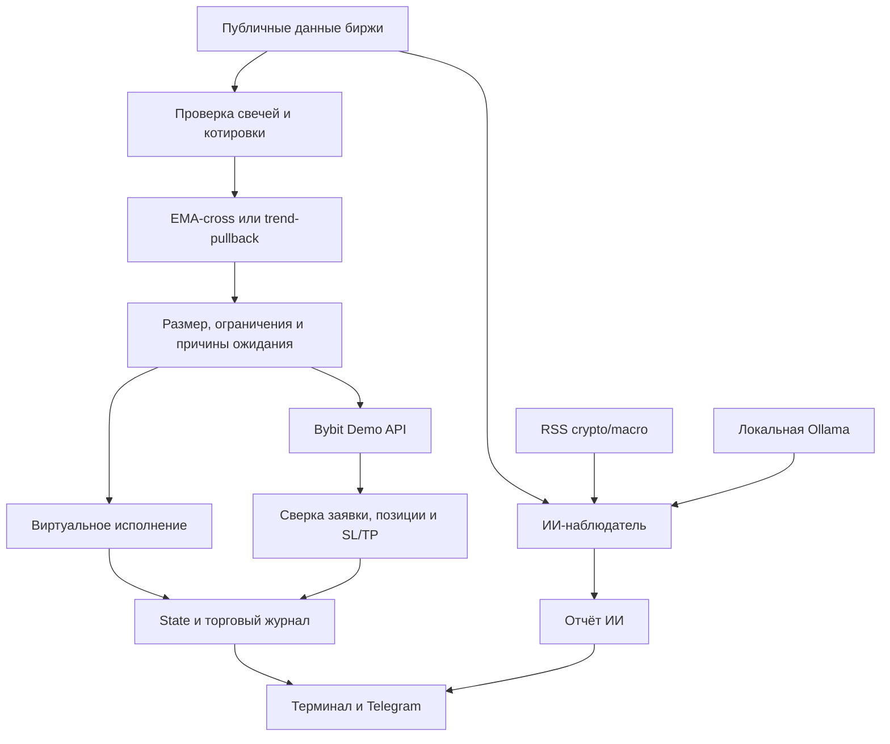

# TradeBot 0.2 — полное руководство пользователя и оператора

[English manual](MANUAL.en.md) · [Главная](../README.md) · [Краткий запуск новой версии](REWORK.ru.md)

Руководство описывает фактически реализованную версию 0.2.0. Основной пример — Mac, VS Code, Python 3.12, BTC/USDT perpetual на Bybit Demo и локальная Ollama. Все пути ниже рассчитаны на `~/Downloads/TradeBot-git`. В другой папке заменяйте путь, а не имена Python-модулей.

## Содержание

1. [Назначение и ограничения](#scope)
2. [Как устроена система](#architecture)
3. [Подготовка Mac и терминала](#prepare)
4. [Первое скачивание и установка](#install)
5. [Миграция из ZIP и обновление](#update)
6. [Первый запуск без ключей](#paper)
7. [Bybit Demo: аккаунт, права, IP, ключи](#bybit)
8. [Telegram: создание, chat ID, подключение](#telegram)
9. [Ollama: установка, модель, проверка](#ollama)
10. [Единый запуск и отдельный агент](#launch)
11. [Повседневный запуск и остановка](#daily)
12. [Режимы и стратегии](#strategies)
13. [Риск, капитал, комиссии и пример объёма](#risk)
14. [Полный справочник параметров](#cli)
15. [Переменные окружения и Связка ключей](#environment)
16. [Вывод, журналы и контроль состояния](#monitoring)
17. [Тест открытия/закрытия](#smoke)
18. [Бэктест и сравнение стратегий](#benchmark)
19. [Состояние, блокировки и восстановление](#recovery)
20. [Ошибки и диагностика](#troubleshooting)
21. [Как собирать данные и оценивать результат](#evaluation)
22. [Карта исходников и дальнейшая разработка](#development)

<a id="scope"></a>
## 1. Назначение и ограничения

TradeBot — экспериментальный проект для исследования правил торговли, виртуальной симуляции и Bybit Demo. Поддерживает публичные данные Binance/Bybit, две детерминированные стратегии и отдельного ИИ-наблюдателя. Реальный торговый режим не реализован.

| Возможность | Что происходит |
|---|---|
| Исторический backtest | Расчёт по закрытым OHLCV, никаких ордеров |
| Realtime paper | Виртуальная позиция по текущим публичным данным |
| Bybit Demo | Настоящие API-заявки, но только в Demo Trading |
| ИИ | Локальный анализ графиков и отобранных заголовков, без торговых инструментов |
| Telegram | Уведомления, без команд управления сделками |

Бот не обещает прибыль и не подтверждён как прибыльная стратегия. Наличие unit-тестов, исполненного Demo-ордера или уверенного ответа модели не доказывает преимущество на рынке. Результаты искусственных сценариев и ограничения проверки опубликованы в [VALIDATION.md](VALIDATION.md).

ИИ не обучается автоматически, не меняет свои веса во время работы, не отменяет риск-ограничения и не определяет ордера. `confidence` — субъективная оценка модели, не вероятность прибыльной сделки.

<a id="architecture"></a>
## 2. Как устроена система



В режиме `--with-ai` одна команда владеет двумя Python-процессами: быстрым торговым циклом и более медленным наблюдателем. Ollama — отдельное приложение/сервер, которое нужно запустить заранее. В дочерний процесс не передаются BYBIT_* и TELEGRAM_*.

Роли в JSON:

- `session` — выбранные режим/стратегия при старте;
- `trader` — проверка рынка, решение и события исполнения;
- `advisor` — отчёт модели, который сам по себе не торгует.

Если вы видите только отчёты `advisor`, это не подтверждение работы трейдера.

<a id="prepare"></a>
## 3. Подготовка Mac и терминала

Установите [VS Code](https://code.visualstudio.com/), [Python 3.12 для macOS](https://www.python.org/downloads/macos/) и Git. Для ИИ также понадобится [Ollama](https://ollama.com/download/mac); совместимость версии macOS уточняйте на её сайте. Python проекта требует минимум 3.11.

Откройте Terminal или **VS Code → Terminal → New Terminal**:

```bash
python3.12 --version
git --version
sw_vers -productVersion
uname -m
```

Последние две команды помогают определить macOS и архитектуру: `arm64` или `x86_64`. На Intel модель может работать заметно медленнее. Разные терминалы, запущенные под Rosetta и без неё, могут использовать разные программы/окружения.

Не копируйте приглашение `(.venv) ➜ ...`, символ `$` и сообщения ошибки как команды. Вводите только содержимое блоков. Для shell используйте обычные ASCII-кавычки `'`/`"`, не типографские `‘’`.

Если VS Code открыт, но не показывает файлы: **File → Open Folder**, выберите именно папку проекта. При исчезнувшем Explorer: Cmd+Shift+P → `View: Reset View Locations`, затем Cmd+Shift+E.

<a id="install"></a>
## 4. Первое скачивание и установка

Этот раздел выполняется один раз. Если Git-копия уже существует, переходите к обновлению.

```bash
cd ~/Downloads
git clone https://github.com/DownSh1fter/TradeBot.git TradeBot-git
cd ~/Downloads/TradeBot-git
pwd
ls pyproject.toml
```

`pwd` должен заканчиваться на `TradeBot-git`, а `ls` — находить файл. Установка из `~/Downloads` не сработает.

```bash
python3.12 -m venv .venv
source .venv/bin/activate
python --version
python -m pip install --upgrade pip
python -m pip install --only-binary=cryptography -e .
python -m unittest discover -s tests -v
```

`-e .` означает editable-установку текущего проекта; точка обязательна. После активации обычно появляется `(.venv)`. Проверка должна выполнить ненулевое число тестов и завершиться `OK`.

`--only-binary=cryptography` предотвращает попытку собирать эту зависимость Rust/maturin на Mac. Если подходящего wheel нет, это вопрос совместимости Python/macOS/архитектуры, а не повод отключать TLS или случайно менять версии зависимостей.

В VS Code выберите **File → Open Folder → Downloads → TradeBot-git**. Можно выбрать интерпретатор через Cmd+Shift+P → `Python: Select Interpreter` → `.venv/bin/python`. Выбор интерпретатора редактора не заменяет `source .venv/bin/activate` в уже открытом терминале.

### Каждая новая вкладка

```bash
cd ~/Downloads/TradeBot-git
source .venv/bin/activate
```

Активация не загружает ключи. Переменные, введённые в другой вкладке, могут отсутствовать. `.env` приложение автоматически не читает.

<a id="update"></a>
## 5. Миграция из ZIP и обновление

ZIP-папка `TradeBot-main` не является обычным Git-checkout. Для дальнейшего `git pull` создайте `TradeBot-git` через clone. Сначала остановите старые процессы, сверяйте позиции/заявки и сохраните старую папку.

Если новая Git-папка ещё не содержит `reports`, перенесите старые журналы:

```bash
cp -R ~/Downloads/TradeBot-main/reports ~/Downloads/TradeBot-git/
```

Пропустите команду, если старого reports нет. Если обе папки уже содержат отчёты, сначала сравните и сделайте резервные копии; не объединяйте вслепую. `.venv` между папками не переносите. Локальные изменения кода сохраняйте отдельно.

Обычное обновление Git-копии — при остановленных трейдере/аналитике:

```bash
cd ~/Downloads/TradeBot-git
git status --short
git pull --ff-only
source .venv/bin/activate
python -m pip install --only-binary=cryptography -e .
python -m unittest discover -s tests -v
```

При конфликте/локальных изменениях остановитесь и сохраните их. Не используйте `git reset --hard`, `git clean`, удаление state или reports для обхода ошибок. Данные reports игнорируются Git, не отправляются в репозиторий и не восстанавливаются автоматически через clone.

Для перехода между стратегиями сначала сверяйте старую позицию. Новую `trend-pullback` начинайте на плоском счёте и с отдельным state; далее возобновляйте именно его. Файл старой стратегии сохраняйте.

<a id="paper"></a>
## 6. Первый запуск без ключей

Отключите Telegram, если пока не хотите его настраивать:

```bash
unset TELEGRAM_BOT_TOKEN TELEGRAM_CHAT_ID
```

Выполните одну paper-итерацию:

```bash
python -m dual_futures_bot --exchange bybit --mode realtime-paper --strategy trend-pullback --timeframe 15m --limit 200 --equity 1000 --fee-rate 0.00055 --cycles 1 --state reports/paper-trend.json
```

Это не создаёт ордер на бирже. Ожидаются `role: session`, затем `role: trader` и запись с `decision`. Пустые `events` нормальны. `--cycles 1` считает попытку опроса; если она пропущена из-за цены, завершение команды ещё не означает успешную проверку рынка.

Для непрерывной виртуальной торговли уберите `--cycles 1`. Проверка пригодна для диагностики получения данных и стратегии; paper не проверяет торговые права Demo-ключа и реальные исполнения.

<a id="bybit"></a>
## 7. Bybit Demo: аккаунт, права, IP и ключи

### Подготовка в веб-интерфейсе

1. Войдите в Bybit и переключитесь в **Demo Trading**. Это не Testnet и не основной торговый счёт.
2. Найдите **API management** именно в Demo и создайте системный ключ.
3. Разрешите чтение и торговлю контрактами: **Read-Write / Orders**. Вывод средств не нужен.
4. Сохраните API Key и API Secret. Секрет может показываться только при создании. Если его нельзя восстановить, замените ключ, а не пытайтесь получить Secret из Key.
5. Для линейного USDT perpetual выберите **one-way**, настройте маржу/плечо в Demo и проверьте виртуальный баланс USDT. Бот эти настройки не переключает.
6. Если ключ ограничен по IP, добавьте текущий внешний адрес подключения/VPN. `192.168...` и другие локальные адреса не подходят. После смены сети/VPN IP может измениться.

Названия пунктов Bybit могут меняться. Правильность ключа определяется ответом Demo API, а не внешним видом страницы. Используйте выделенный аккаунт/символ без другого бота и ручных сделок.

### Ввод API Key — отдельно от текста команды

В той вкладке, где запустите торговлю, выполните **только строку**:

```bash
read -r -s BYBIT_DEMO_API_KEY
```

После Enter терминал молча ждёт. Вставьте **только значение API Key** через Cmd+V → Enter. Ни символов, ни звёздочек не будет — это скрытый ввод. Теперь:

```bash
export BYBIT_DEMO_API_KEY
echo
```

Для Secret:

```bash
read -r -s BYBIT_DEMO_API_SECRET
```

Вставьте Secret → Enter, затем:

```bash
export BYBIT_DEMO_API_SECRET
echo
```

Эти команды одинаково подходят bash/zsh. Имя переменной НЕ заменяется ключом. Не вставляйте сразу следующий блок команд, пока `read` ожидает значение. Кавычки вокруг самого скрытого значения не нужны.

### Проверка без раскрытия значений

```bash
python - <<'PY'
import os
for name in ('BYBIT_DEMO_API_KEY', 'BYBIT_DEMO_API_SECRET'):
    value = os.environ.get(name, '')
    ok = bool(value) and value.isascii() and not any(c.isspace() for c in value)
    print(name, 'format OK' if ok else 'missing or invalid characters')
PY
```

Format OK не подтверждает права/API-аутентификацию. Не выводите значения через echo/printenv и не отправляйте ключи в чат. Если токен/ключ был виден в сообщении или скриншоте, отзовите его и создайте новый.

<a id="telegram"></a>
## 8. Telegram: подключение и проверка

1. Откройте проверенного **@BotFather** → `/newbot`. Задайте имя/username и получите токен.
2. Откройте своего нового бота → **Start** или `/start`. Без этого он может не иметь возможности писать вам.
3. Для личного чата узнайте числовой `Id` через **@userinfobot**. Ему не нужен токен вашего бота. Это не номер телефона и не @username. Для группы используйте её ID и права отправки; участники группы увидят сведения о счёте.

В текущей торговой вкладке:

```bash
read -r -s TELEGRAM_BOT_TOKEN
```

Вставьте токен → Enter. После возврата приглашения:

```bash
export TELEGRAM_BOT_TOKEN
echo
```

Теперь видимый ввод chat ID:

```bash
read -r TELEGRAM_CHAT_ID
```

Введите только число → Enter, затем:

```bash
export TELEGRAM_CHAT_ID
export TELEGRAM_STATUS_SECONDS='300'
```

Тест без ордеров:

```bash
python - <<'PY'
import os
from dual_futures_bot.telegram import Telegram
if not os.environ.get('TELEGRAM_BOT_TOKEN') or not os.environ.get('TELEGRAM_CHAT_ID'):
    print('Token or chat ID is empty')
else:
    notifier = Telegram.from_env()
    try:
        ok = notifier.send('Connection test', {'message': 'TradeBot connected; no orders sent'})
        print('Sent' if ok else 'Delivery failed')
    finally:
        notifier.close()
PY
```

Уведомления включают запуск/остановку/ошибки, события ордеров, изменения снимка позиции и сводку рынка/решения/ИИ. Частота сводки по умолчанию 300 секунд, минимум 30. Команд Telegram для покупки/продажи нет.

Отправка синхронная с коротким таймаутом; ошибка не повторяет торговый ордер, но сообщение может потеряться. Очереди доставки нет. Текст ограничен 4000 символами и может обрезаться. Для полной сверки используйте журнал и Bybit. Полное открытие/закрытие между опросами может не попасть в уведомления.

Отключение — убрать ОБЕ переменные:

```bash
unset TELEGRAM_BOT_TOKEN TELEGRAM_CHAT_ID
```

Наличие только одной переменной считается ошибкой конфигурации.

<a id="ollama"></a>
## 9. Ollama и модель

Установите приложение в Applications, откройте его. Проверка:

```bash
ollama --version
ollama list
```

Если CLI не найден, используйте полный путь:

```bash
/Applications/Ollama.app/Contents/Resources/ollama --version
```

Если приложение не обслуживает запросы, в отдельной вкладке:

```bash
/Applications/Ollama.app/Contents/Resources/ollama serve
```

Не запускайте второй сервер на занятом порту. Оставьте сервер работающим. Модель скачайте один раз из другой вкладки:

```bash
/Applications/Ollama.app/Contents/Resources/ollama pull qwen2.5:3b
```

Облачный API-ключ не нужен. Модель требует диск, RAM и вычисления; число 3b не означает размер RAM. На медленном Mac можно попробовать `qwen2.5:1.5b`, на более мощном — `qwen2.5:7b`, предварительно скачав и указав точный тег. Меньшая модель может хуже соблюдать формат и рассуждать.

Отдельная проверка наблюдателя, без торговли:

```bash
python -m dual_futures_bot.ai_advisor --exchange bybit --timeframe 15m --cycles 1 --timeout 480 --max-tokens 512
```

Этапы `loading public market data`, `loading news feeds`, `waiting for Ollama` означают выполнение работы. Итог `status: ok` — валидный ответ; `status: error` требует чтения `error_type` и `hint`. В логе Ollama растущий `n_gen` означает генерацию. Отмена через 2 минуты характерна для старого клиентского таймаута; обновите код и используйте 480 секунд.

ИИ получает основной и часовой графики, EMA/ATR, доходности 1/4/16 свечей, относительный объём и до 20 отобранных crypto/macro-заголовков за 24 часа. До трёх HTTPS redirect допускаются, переход на HTTP запрещён. Ошибки источников видны в `news_coverage`; успешный ответ модели не означает, что все новости загрузились. Текст новостей не является инструкцией к исполнению. Это не полноценный экономический календарь, полные статьи или поток всего интернета.

<a id="launch"></a>
## 10. Единый запуск и отдельный агент

### Вариант A: рекомендуемая простая схема

Работают Ollama и одна команда TradeBot. Старого отдельно запущенного агента остановите.

Paper + собственный ИИ:

```bash
python -m dual_futures_bot --exchange bybit --mode realtime-paper --strategy trend-pullback --timeframe 15m --limit 200 --equity 1000 --fee-rate 0.00055 --with-ai --state reports/paper-trend.json
```

Demo + собственный ИИ, только при заданных ключах и после сверки отсутствия прежней позиции/заявок:

```bash
python -m dual_futures_bot --exchange bybit --mode bybit-demo --strategy trend-pullback --timeframe 15m --limit 200 --equity 1000 --fee-rate 0.00055 --with-ai --state reports/demo-trend.json
```

Вторая команда может отправить Demo-ордер. Проверяйте правильный режим. Вывод агента уходит в `reports/ai-advisor.log`; его история — `reports/ai-advisor.history.jsonl`. Трейдер остаётся в текущем терминале. Без ИИ уберите `--with-ai`.

Проверка прогресса дочернего процесса из отдельной вкладки:

```bash
tail -n 20 reports/ai-advisor.log
```

### Вариант B: процессы отдельно

В одной вкладке запущен `ollama serve` или приложение, во второй — наблюдатель, в третьей — трейдер. Во второй и третьей активируйте `.venv` отдельно.

Наблюдатель:

```bash
python -m dual_futures_bot.ai_advisor --exchange bybit --timeframe 15m --interval 60 --timeout 480 --max-tokens 512
```

Трейдер:

```bash
python -m dual_futures_bot --exchange bybit --mode bybit-demo --strategy trend-pullback --timeframe 15m --limit 200 --equity 1000 --fee-rate 0.00055 --ai-report reports/ai-advisor.json --state reports/demo-trend.json
```

Здесь НЕ добавляйте `--with-ai`, иначе конфликт с уже работающим наблюдателем. У отдельного агента история по умолчанию `reports/ai-history.jsonl`; у управляемого дочернего — `reports/ai-advisor.history.jsonl`.

Если меняете symbol/timeframe/report, эти значения должны совпадать у трейдера и наблюдателя. Не используйте один report/state для разных рынков.

<a id="daily"></a>
## 11. Повседневная работа

Порядок запуска: открыть правильную папку → активировать окружение → задать секреты/Telegram в торговой вкладке → проверить Demo-позиции/заявки → запустить Ollama при необходимости → запустить один трейдер с прежним state и параметрами.

Запущенный Mac должен иметь сеть и не спать. Для предотвращения автоматического idle sleep во время процесса можно использовать встроенный macOS wrapper:

```bash
caffeinate -i python -m dual_futures_bot --exchange bybit --mode bybit-demo --strategy trend-pullback --limit 200 --equity 1000 --fee-rate 0.00055 --with-ai --state reports/demo-trend.json
```

Это не обещает работы при закрытой крышке, выключении, потере сети или закрытии терминала. Не считайте wrapper сервером/сервисом.

Остановка: Ctrl+C в терминале трейдера. Собственный дочерний агент остановится; отдельно запущенный — нет. Ollama остаётся отдельным приложением. **Позиции и биржевые ордера при остановке не закрываются.** Принятые биржей SL/TP могут продолжать действовать — проверьте их в Bybit.

После аварии/сна/отключения сначала сверяйте биржу и pending_order, а не автоматически перезапускайте процесс. Смена ключей, сети или IP может потребовать обновления настроек. При новой вкладке секреты нужно загрузить заново; Ctrl+C в прежней вкладке сам по себе их не очищает.

<a id="strategies"></a>
## 12. Стратегии и частота сделок

### EMA-cross — старый режим по умолчанию

EMA20 пересекает EMA50 на закрытой свече: вверх long, вниз short. Онлайн оценивается последняя закрытая свеча; пропущенные при простое сигналы не воспроизводятся. Стоп 2 ATR, в paper он подтягивается; в Demo первоначальный стоп не подтягивается автоматически. Свежего пересечения может не быть часами.

### Trend-pullback-v1 — выбирается явно

`--strategy trend-pullback` включает правила из [подробного описания](REWORK.ru.md): разрыв EMA минимум 0.25 ATR, совпадающий наклон EMA20 за три свечи, допустимая волатильность и объём, контакт с зоной EMA20 за три свечи, подтверждение отскока, расстояние до цели относительно расходов. Онлайн также проверяются спред до 0.08% и отсутствие ухода текущей цены дальше ATR от сигнального close.

Stop Loss 2 ATR, Take Profit 3 ATR, выход при сломе EMA-тренда или удержании 24 свечи. После закрытия три свечи cooldown. Trailing здесь нет. При 15m лимит удержания соответствует 6 часам, cooldown — 45 минут. Это вычисление длительности, не обещание сделки/выхода строго в этот момент при остановленном/неисправном процессе.

Ни одна стратегия не открывает сделку только потому, что прошло 30 минут или два часа. Более короткий timeframe увеличивает шум и расходы, не обязательно прибыль. Не меняйте его на ходу с прежним state. ИИ neutral не блокирует сделку, bullish не вызывает её.

<a id="risk"></a>
## 13. Риск и деньги: что означает equity

`--equity 1000` — выделенная база расчёта, а не покупка на 1000 каждый раз и не гарантированный предел потерь. В новой стратегии размер ограничен меньшим из текущего капитала и initial equity.

| Ограничение | Текущее значение | Где задаётся |
|---|---|---|
| Риск сделки | 0.0025 = 0.25% | `RiskConfig.risk_fraction` |
| Максимальный номинал | 0.25 = 25% базы | `RiskConfig.max_notional_fraction` |
| Дневной бюджет потерь | 0.01 = 1% базы | `RiskConfig.max_daily_loss_fraction` |
| Первоначальный стоп | 2 ATR | `RiskConfig.stop_atr_multiple` |
| Цель trend | 3 ATR | `policy.py` |
| Максимум удержания trend | 24 свечи | `policy.py` |
| Cooldown trend | 3 свечи | `policy.py` |

Из перечисленного CLI меняет equity и модельные расходы. Флагов `--risk`, `--leverage`, `--stop`, `--take-profit`, `--live` в текущей версии НЕТ. Остальные изменения — отдельная правка кода с тестами и сверкой состояния; не изобретайте несуществующие команды.

Приближённо для trend:

```text
base = min(observed_equity, configured_equity)
risk_money = base × 0.0025
unit_budget = abs(reference_price - rounded_stop) + reference_price × 2 × (fee_rate + slippage_rate)
base_quantity = min(risk_money / unit_budget, base × 0.25 / reference_price)
contracts = округление вниз (base_quantity / contractSize)
```

Пример: base 1000, цена 80000, ATR 150, стоп в 300, fee 0.00055 и slippage 0.0002 с каждой стороны. Риск 2.5 USDT; расход на единицу 120; размер по риску примерно 0.00595 BTC, по номиналу 0.003125 BTC. При contractSize 1 и шаге 0.001 получается 0.003 BTC, около 240 USDT. Это арифметический пример, не предписание объёма или гарантия fill.

Если размер ниже биржевого минимума, бот ждёт, а не увеличивает риск. В новой Demo-политике номинал также не превышает свободный USDT; плечо не используется для увеличения расчётного размера и не переключается API.

Для trend дневной бюджет — 1% меньшего из equity на начало наблюдаемого UTC-дня и заданного equity. При allocation 1000 и Demo-балансе 100000 бюджет 10 USDT. В Demo предпочтительно используется USDT coin equity Bybit, иначе wallet плюс unrealized PnL выбранной позиции. Paper/backtest дневной контроль опирается на учтённый баланс/результат, не полную биржевую маржинальную модель. В legacy дневная база — наблюдаемый стартовый капитал без нового allocation-cap. Счёт должен быть выделенным: чужие операции/депозиты и другие позиции искажают контроль.

Лимит блокирует новые входы, но не отменяет защитные выходы и не гарантирует максимум потерь: гэпы, комиссии, funding, ликвидации и сбой могут дать больший убыток. Funding отсутствует в модельном фильтре и бэктесте, хотя фактическое изменение биржевого equity может включать его.

Комиссия 0.00055 в примерах — допущение, а не установленный тариф вашего Bybit-аккаунта. Укажите реалистичные расходы для своих условий. Slippage тоже является допущением, а не управлением фактической ценой исполнения.

<a id="cli"></a>
## 14. Полный справочник команд

Справка не отправляет ордеров:

```bash
python -m dual_futures_bot --help
python -m dual_futures_bot.ai_advisor --help
python -m dual_futures_bot.demo_smoke --help
python -m dual_futures_bot.benchmark --help
```

### Основной модуль

| Параметр | По умолчанию | Значение/ограничение |
|---|---|---|
| `--exchange` | обязательный | binance/bybit; Demo только bybit |
| `--mode` | backtest | backtest/realtime-paper/bybit-demo |
| `--strategy` | ema-cross | ema-cross/trend-pullback |
| `--symbol` | BTC/USDT:USDT | CCXT unified symbol, не BTCUSDT; онлайн linear USDT swap |
| `--timeframe` | 15m | Поддерживаемый биржей интервал |
| `--limit` | 1000 | 60–1500 запрошенных свечей; биржа может вернуть меньше |
| `--equity` | 10000 | Положительное конечное число |
| `--poll-seconds` | 10 | Не меньше 1, онлайн |
| `--cycles` | 0 | 0 — непрерывно, иначе число попыток, включая пропуски |
| `--state` | reports/realtime-state.json | State онлайна; задавайте отдельный явный путь |
| `--ai-report` | отсутствует | Чтение чужого/собственного отчёта, без влияния на сигналы |
| `--with-ai` | выключен | Запустить своего наблюдателя; не для backtest |
| `--ai-model` | qwen2.5:3b | Модель дочернего наблюдателя |
| `--ai-timeout` | 480 | 30–540 секунд ожидания ответа |
| `--ai-interval` | 60 | Пауза после анализа, минимум 60 секунд |
| `--ai-max-tokens` | 512 | 256–2048 токенов ответа |
| `--fee-rate` | 0.0005 | Предполагаемая комиссия с каждой стороны, не чтение тарифа |
| `--slippage-rate` | 0.0002 | Предполагаемое неблагоприятное проскальзывание с каждой стороны |
| `--candles-json` | отсутствует | Только backtest: JSON-массив OHLCV вместо загрузки |

При включении `--with-ai` без пути report выбирается `reports/ai-advisor.json`. Значения параметров AI валидируются основным CLI даже если модель не включена. Минимум 60 закрытых свечей нужен после удаления незакрытой; `--limit 60` может вернуть только 59 пригодных, поэтому в примерах 200.

### Отдельный ai_advisor

| Параметр | Default | Примечание |
|---|---|---|
| `--exchange` | bybit | bybit/binance |
| `--symbol` | BTC/USDT:USDT | Должен совпадать с трейдером |
| `--timeframe` | 15m | Дополнительно анализируется 1h |
| `--model` | qwen2.5:3b | Точный скачанный тег |
| `--timeout` | 300 | 30–540; отличается от default дочернего режима 480 |
| `--max-tokens` | 512 | 256–2048 |
| `--feed` | BBC World + CoinDesk | Повторяемый HTTPS RSS/Atom URL, максимум 5; заменяет defaults |
| `--report` | reports/ai-advisor.json | Последний отчёт |
| `--history` | reports/ai-history.jsonl | История отдельного режима |
| `--interval` | 300 | Пауза после завершения, минимум 60 |
| `--cycles` | 0 | Число анализов, 0 — непрерывно |

Для собственных feeds запускайте наблюдателя отдельно с `--feed`. Основной `--with-ai` не имеет флага передачи RSS-лент.

### demo_smoke

`--symbol` default BTC/USDT:USDT; `--max-notional` default 250, диапазон (0,250]; `--execute` обязательно явно разрешает Demo-вход/выход; `--journal` default reports/demo-smoke.json. Биржа всегда Bybit Demo.

### benchmark

`--input` обязательный JSON OHLCV; `--output` default reports/benchmark.json; `--equity` default 1000; `--fee-rate` default 0.0005; `--slippage-rate` default 0.0002. Требуется минимум 240 свечей. Здесь нет `--with-ai` и ордеров.

<a id="environment"></a>
## 15. Переменные окружения и необязательное постоянное хранение

| Переменная | Где нужна | Тип |
|---|---|---|
| BYBIT_DEMO_API_KEY | Demo trader/smoke | Секрет |
| BYBIT_DEMO_API_SECRET | Demo trader/smoke | Секрет для локальной HMAC-подписи |
| TELEGRAM_BOT_TOKEN | Трейдер с уведомлениями | Секрет |
| TELEGRAM_CHAT_ID | Трейдер с уведомлениями | Числовой ID, чувствительные метаданные чата |
| TELEGRAM_STATUS_SECONDS | Telegram | Необязательно, default 300, >=30 |

Paper, backtest и AI не требуют Bybit-ключей. Задать переменную в shell без `export` недостаточно для Python. `source .venv/bin/activate` не читает `.env`, Keychain или другой терминал.

### Необязательный Mac Keychain

Чтобы не вставлять секреты каждый раз, можно вручную создать в **Keychain Access / Связка ключей** generic password items с account `tradebot` и именами `TradeBot-Bybit-Demo-Key`, `TradeBot-Bybit-Demo-Secret`, `TradeBot-Telegram-Token`. В поле password сохраните соответствующее значение. Это настройка macOS, не встроенный мастер бота. Точный вид интерфейса зависит от macOS.

Загрузка из Keychain в текущую shell (macOS может спросить разрешение):

```bash
BYBIT_DEMO_API_KEY="$(security find-generic-password -a tradebot -s TradeBot-Bybit-Demo-Key -w)" && export BYBIT_DEMO_API_KEY
BYBIT_DEMO_API_SECRET="$(security find-generic-password -a tradebot -s TradeBot-Bybit-Demo-Secret -w)" && export BYBIT_DEMO_API_SECRET
TELEGRAM_BOT_TOKEN="$(security find-generic-password -a tradebot -s TradeBot-Telegram-Token -w)" && export TELEGRAM_BOT_TOKEN
```

Chat ID введите через обычный `read` из раздела Telegram. Значения не вставляются в текст shell-команды; история содержит команды обращения к Keychain, не подставленные секреты. Не добавляйте echo для проверки. Этот способ требует существующих элементов и доступной Связки ключей; при ошибке используйте скрытый read. Mac Keychain-команды здесь описаны для локального использования, в облаке не исполнялись.

Для очистки текущей вкладки:

```bash
unset BYBIT_DEMO_API_KEY BYBIT_DEMO_API_SECRET TELEGRAM_BOT_TOKEN TELEGRAM_CHAT_ID
```

Это не удаляет ключи на Bybit и не отзывает Telegram-токен; для отзыва используйте соответствующие сервисы. В переменные shell и дочернего трейдера секреты всё равно попадают — Keychain не делает запущенный процесс защищённым от владельца компьютера.

<a id="monitoring"></a>
## 16. Вывод и журналы

| Поле | Смысл |
|---|---|
| role | session/trader/advisor; сначала установите, чей лог читаете |
| analysis.signal | long/short/null, технический сигнал |
| analysis.signal_reason | Результат проверки стратегии на последней свече |
| decision.action | wait/hold/enter/exit |
| decision.reason | Фактическое решение с учётом состояния/биржевых ограничений |
| events | Новые события этой итерации |
| equity | Виртуальный баланс или наблюдаемое Demo equity |
| positions | Paper-позиция или снимок Demo-позиций |
| analysis.quote_source | ticker_last/orderbook_midpoint |
| analysis.quote_age_seconds | Возраст относительно локального времени; возможен малый минус |
| analysis.ai_advisor | Отдельная оценка модели, не приказ |

Основные причины ожидания: `awaiting_ema_cross`, `awaiting_next_closed_candle`, `weak_trend`, `trend_slope_conflict`, `low_volume`, `low_volatility`, `high_volatility`, `price_too_far_from_ema`, `no_recent_pullback`, `rebound_not_confirmed`, `target_too_small_for_costs`, `spread_too_wide`, `spread_unavailable`, `entry_price_moved`, `post_exit_cooldown`, `daily_loss_limit`, `below_exchange_minimum`, `above_exchange_maximum`, `insufficient_free_balance_without_leverage`, `rounded_size_exceeds_risk`, `quote_expired_before_order`, `position_open`. Некорректные контракт/округление дают отдельные причины `invalid_*`.

`signal` может быть long, но `decision` wait из-за лимита/минимума/уже обработанной свечи. Смотрите оба поля. Paper после выхода может показать wait/cooldown, при этом `events` содержит exit.

У Demo-события `status: closed` означает завершённый ордер, не доказательство закрытой позиции. Для выхода нужен reduce_only, подтверждённое отсутствие позиции и сверка Bybit. `position_closed_observed` означает исчезновение позиции между опросами; не устанавливает причину, цену и PnL.

### Пути для рекомендуемого запуска

| Файл | Назначение |
|---|---|
| reports/demo-trend.json | Текущее Demo-состояние |
| reports/demo-trend.jsonl | Принятые циклы и отклонённые котировки |
| reports/demo-trend.json.lock | Lock state |
| reports/.execution_bybit_BTC_USDT_USDT.lock | Общая локальная защита Demo-исполнителя |
| reports/ai-advisor.json | Последний AI-report |
| reports/ai-advisor.json.lock | Lock наблюдателя |
| reports/ai-advisor.log | Лог дочернего AI |
| reports/ai-advisor.history.jsonl | История дочернего AI |
| reports/ai-history.jsonl | Default истории отдельно запущенного AI |

State — последняя известная картина, не текущее состояние биржи. При отключении он перестаёт обновляться. Audit не является полным реестром всех биржевых исполнений/funding.

Последние записи:

```bash
tail -n 3 reports/demo-trend.jsonl
tail -n 20 reports/ai-advisor.log
ls -la reports
```

Компактная диагностика без вывода секретов:

```bash
python - <<'PY'
import json
import time
from pathlib import Path
for name in ('reports/demo-trend.json', 'reports/ai-advisor.json'):
    path = Path(name)
    if not path.exists():
        print(name, 'missing')
        continue
    row = json.loads(path.read_text())
    print(name, 'status=', row.get('status'), 'decision=', row.get('decision'))
    print('pending_order=', bool(row.get('pending_order')), 'error_type=', row.get('error_type'), 'hint=', row.get('hint'))
    if row.get('data_at') is not None:
        print('AI input age, seconds=', round((time.time()*1000-row['data_at'])/1000, 1))
PY
```

Отчёт ИИ принимается только при совпадении рынка/схемы и возрасте исходных данных до 10 минут. Возраст считается от `data_at`, а не конца генерации; медленный ответ может уже устареть. `unavailable_or_stale` описывает доступность наблюдателя, а торговый цикл работает независимо.

Для записи терминала с сохранением статуса ошибки shell:

```bash
set -o pipefail
python -m dual_futures_bot --exchange bybit --mode realtime-paper --strategy trend-pullback --limit 200 --equity 1000 --fee-rate 0.00055 --state reports/paper-trend.json 2>&1 | tee -a reports/session.log
```

Это отдельный запуск paper, не команда поверх уже работающего экземпляра с тем же state. Директория reports должна существовать. Логи растут без ротации; архивируйте при остановленном процессе. Они содержат финансовые сведения и текст новостей — проверяйте перед отправкой.

<a id="smoke"></a>
## 17. Явная проверка исполнения

Только если остановлены все стратегии/другие тесты и в Bybit Demo нет позиции/ордеров на символе:

```bash
python -m dual_futures_bot.demo_smoke --execute --max-notional 250
```

Тест отправляет один рыночный long со страховочным стопом и затем рыночный reduce-only exit без графического сигнала. Номинал по опорной цене ограничен меньшим из 250 и 25% свободного USDT; точная стоимость исполнения может отличаться. Предназначен для проверки API-пути, а не доходности. Не использует Telegram или ИИ и не должен запускаться параллельно стратегии.

Успех:

```text
DEMO ROUNDTRIP OK: no position and no open orders for this symbol.
```

`reports/demo-smoke.json` — одноразовый журнал. Если он уже есть, не удаляйте ради повтора. Прочитайте, сверяйте Bybit и только после подтверждённого завершения/отсутствия позиции допускается новое имя через `--journal`. Подробнее: [Smoke test](DEMO_SMOKE.ru.md).

<a id="benchmark"></a>
## 18. Историческая проверка

Быстрый backtest скачивает публичные закрытые свечи, не требует ключей:

```bash
python -m dual_futures_bot --exchange bybit --mode backtest --strategy trend-pullback --timeframe 15m --limit 1000 --equity 1000 --fee-rate 0.00055
```

Отчёт записывается в reports с именем биржа/символ/timeframe. Повтор этой комбинации, даже с другой стратегией, перезаписывает отчёт: сохраните копию или используйте сравнительный benchmark.

Чтобы сравнить обе политики на одном неизменяемом наборе:

```bash
python - <<'PY'
import json
from pathlib import Path
from dual_futures_bot.market_data import fetch_candles
path = Path('reports/BTCUSDT-15m-sample.json')
if path.exists():
    raise SystemExit('Dataset exists: preserve it or choose another name')
rows = fetch_candles('bybit', 'BTC/USDT:USDT', '15m', 1000)
path.parent.mkdir(parents=True, exist_ok=True)
path.write_text(json.dumps([[c.timestamp, c.open, c.high, c.low, c.close, c.volume] for c in rows]))
print('Saved closed candles:', len(rows))
PY
python -m dual_futures_bot.benchmark --input reports/BTCUSDT-15m-sample.json --output reports/benchmark.json --equity 1000 --fee-rate 0.00055 --slippage-rate 0.0002
```

Формат файла: массив строк `[timestamp_ms, open, high, low, close, volume]`. Без текстовых заголовков, timestamp — начало свечи в Unix milliseconds; цены положительные, объём неотрицательный, значения конечные, интервалы непрерывные/одинаковые, порядок строго по времени. Не заполняйте пропуски выдуманными сделками. Для benchmark минимум 240 свечей, для simulate 60.

Benchmark фиксирует SHA256, сравнивает первые 2/3 и последнюю треть с до 200 предыдущими свечами для прогрева без сделок в нём. Параметры не обучаются и автоматически не выбираются. Это не полноценный walk-forward с подбором параметров.

`net_pnl` — модельный чистый результат, `fees_paid` — комиссии, `win_rate` — доля, а не процент. `max_drawdown_fraction` относится к реализованному капиталу, `max_mark_to_market_drawdown_fraction` — оценке по закрытиям свечей, не худшей внутрисвечной просадке. При касании SL и TP в одной OHLC-свече движок выбирает стоп первым. На последней свече позиция принудительно закрывается для отчёта.

Исторический движок не учитывает funding/ликвидации, реальный стакан и биржевые объёмные минимумы/шаги. Реальные online-ограничения и прогрев индикаторов дают отличия. Короткий период и красивый PnL не подтверждают будущий результат.

<a id="recovery"></a>
## 19. Состояние, lock и аварийное восстановление

### Что входит в идентичность state

Биржа, символ, timeframe, режим paper/Demo, значения RiskConfig; у новой стратегии — `trend-pullback-v1`. Смена equity, расходов или стратегии может дать несовпадение. Обычный перезапуск должен использовать прежние параметры и путь.

Не используйте новый state для обхода чужой позиции, pending_order или несовпадения параметров. Сверьте биржу, сохраните историю и только при осознанном чистом новом эксперименте создайте другой state. Paper-позиция тоже сохраняется; её удаление обрывает историю симуляции.

### При неизвестном результате ордера

1. Остановите процессы, не повторяйте команду отправки и не запускайте smoke.
2. Прочитайте state и pending_order/client_id. Сохраните копию state/журнала.
3. В Bybit Demo найдите orderLinkId/client ID, исполнения, текущую позицию, открытые заявки, SL/TP.
4. Если позиция есть без защиты, сначала защитите или закройте её вручную через Demo-интерфейс.
5. Только после сверки решайте, можно ли возобновить исходный state. Установка pending_order в null без проверки может привести к дублированию сделки.

Контрольный модуль не перезапускает неизвестную заявку автоматически. Опрос уже известного ID — чтение, а не новая отправка. Защитные reduce-only SL/TP собственной позиции распознаются; посторонние заявки останавливают работу.

### При оставшемся lock

Проверьте процессы:

```bash
pgrep -fl 'dual_futures_bot'
```

Если нужный процесс работает, остановите его в его терминале. Только после подтверждения отсутствия процесса и сверки биржи разрешено удалить соответствующий lock, не state:

```bash
rm reports/demo-trend.json.lock
```

Для стандартного report агента:

```bash
rm reports/ai-advisor.json.lock
```

Для общего Demo-lock BTCUSDT, только когда нет ни одного трейдера этого символа в checkout:

```bash
rm reports/.execution_bybit_BTC_USDT_USDT.lock
```

Не выполняйте все rm «на всякий случай» и не используйте wildcard. При другом пути state/report/symbol имена меняются. Журнал smoke `.json` не является lock. Защита локальна: другой checkout/компьютер может обойти её, поэтому не запускайте там параллельный трейдер.

Восстановление backup не откатывает биржу. Старая копия state не становится актуальной после копирования; сначала сверяйте нынешние позиции/исполнения.

<a id="troubleshooting"></a>
## 20. Ошибки и диагностика

| Симптом | Причина / действие |
|---|---|
| `python: command not found` | Активировать .venv в правильной вкладке |
| Python 3.9 несовместим | Создать окружение через python3.12; старое сохранить отдельно |
| Нет pyproject.toml | `pwd`; перейти из Downloads в TradeBot-git |
| `No module named dual_futures_bot` | Editable install из корня текущей папки |
| Нет ai_advisor/неизвестен --with-ai | Старый код/окружение; Git update и повторная установка |
| maturin/cargo/cryptography | Upgrade pip, binary cryptography, проверить macOS/архитектуру |
| `quote>` | Незакрытые/типографские кавычки; Ctrl+C, заново команду |
| read молчит | Это скрытый ввод, Cmd+V → Enter |
| API-переменные пустые | Новая вкладка или нет export; повторить ввод |
| UnicodeEncodeError latin-1 | В значении ключа посторонний/кириллический текст |
| Bybit 10005 | Нет нужных торговых/контрактных прав Demo API |
| Bybit 10010 | Внешний IP/VPN не совпадает с привязкой ключа |
| Telegram empty | Нужны и token, и chat ID в текущей вкладке |
| Telegram 401 | Неверный/отозванный токен |
| Telegram 400 chat not found | ID или не нажат Start у своего бота |
| Telegram 403 | Блокировка бота/нет прав в чате |
| Ollama command not found | Установка приложения/полный путь |
| Ollama could not connect | Запустить приложение или один serve |
| Ollama port in use | Уже есть сервер; не запускайте второй |
| Ollama долго генерирует | Посмотреть n_gen/tokens per second, ждать до таймаута; меньшая модель |
| Ollama timeout/500 | Проверить hint/серверный лог; обновить клиент, --timeout 480 |
| TruncatedModelResponse | --max-tokens 768; это дольше, не доказанно качественнее |
| `quote_unavailable` | Цикл пропущен без ордеров; смотреть reason/source/age_seconds |
| `future_timestamp` | Допускается только до 2 секунд опережения; проверить часы |
| `stale_quote` | Возраст выше 60 секунд; проверить источник/сеть, не отключать защиту |
| `quote_recovered` | Цена снова пригодна, нормальный цикл возобновлён |
| `unavailable_or_stale` AI | Нет отчёта, ошибка, другой рынок/путь или возраст >10 минут |
| `Unmanaged position` | Новая стратегия не владеет существующей позицией; сверить, не удалять state |
| Unrecognized open orders | Есть нераспознанные/посторонние заявки; сверить Bybit |
| Stop/target unconfirmed | Ордер мог исполниться; проверить защиту и pending_order |
| FileExistsError smoke | Журнал уже существует; сначала сверить предыдущую попытку |
| FileExistsError state/execution lock | Сначала проверить процессы, потом процедуру восстановления |
| Несовпадение state | Использовать исходные параметры; не создавать обходной state |
| Долго нет сделок | Смотреть role и decision.reason, а не число сообщений модели |

### Узнать причину отказа Telegram без токена в выводе

```bash
python - <<'PY'
import os
import requests
token = os.environ.get('TELEGRAM_BOT_TOKEN', '').strip()
chat = os.environ.get('TELEGRAM_CHAT_ID', '').strip()
if not token or not chat:
    print('Token or chat ID is empty')
else:
    try:
        response = requests.post(f'https://api.telegram.org/bot{token}/sendMessage',
                                json={'chat_id': chat, 'text': 'TradeBot diagnostic test'}, timeout=10)
        data = response.json()
        print('HTTP:', response.status_code)
        print('Result:', data.get('description', 'Sent' if data.get('ok') else 'Unknown response'))
    except Exception as exc:
        print('Connection error:', type(exc).__name__)
PY
```

### Проверить часы и цену без ключей и ордеров

```bash
python - <<'PY'
import ccxt
exchange = ccxt.bybit({'enableRateLimit': True, 'trust_env': True, 'timeout': 20000})
exchange.enable_demo_trading(True)
try:
    exchange.load_markets()
    book = exchange.fetch_order_book('BTC/USDT:USDT', limit=1)
    before = exchange.milliseconds()
    server = exchange.fetch_time()
    after = exchange.milliseconds()
    print('Clock difference, ms:', server-(before+after)//2)
    print('Time-request roundtrip, ms:', after-before)
    stamp = book.get('timestamp')
    print('Book age vs Mac, s:', None if stamp is None else (after-stamp)/1000)
    print('Book age vs Bybit, s:', None if stamp is None else (server-stamp)/1000)
finally:
    close = getattr(exchange, 'close', None)
    if close:
        close()
PY
```

Это измерение сейчас, не доказательство пригодности цены в момент предыдущего сбоя. В trade journal сохраняется возраст отвергнутой цены. При отсутствии цены paper-стопы не могут отработать; Demo-ордеры в пропущенном цикле не отправляются, старые позиции могут оставаться.

Когда нужна помощь, пришлите команду без секретов, pwd, версии Python/macOS/архитектуру, последние 2–3 trading JSONL и traceback. Лог одного advisor не показывает исполнение ордеров.

<a id="evaluation"></a>
## 21. Данные для будущего ML и оценка результата

Сейчас сохраняются наблюдения и модельные рекомендации, но веса Ollama не обучаются. Для полноценного датасета дополнительно нужны временно согласованные будущие исходы: доходности через фиксированные горизонты, реальные исполнения/комиссии/funding, метки доступной на тот момент информации и сравнение с baseline. Audit сейчас не заменяет полный реестр биржевых исполнений.

Оценивайте чистый PnL после расходов, просадку, число и оборот сделок, среднюю прибыль/убыток, долю пропущенных котировок, причины отказов, качество исполнения и отдельную пользу ИИ. Не меняйте одновременно много параметров и не выбирайте удачный исторический отрезок для рекламы результата. Нужны независимые будущие периоды, разные режимы и продолжительный Demo.

Чем чаще сделки и меньше цели, тем важнее издержки. Увеличение частоты ради появления событий может ухудшить результат. Рост количества отчётов модели не является ростом торгового качества.

<a id="development"></a>
## 22. Исходники, проверка и дополнительные материалы

| Модуль | Ответственность |
|---|---|
| __main__.py | CLI и выбор режима/управляемого агента |
| market_data.py | Публичные OHLCV |
| indicators.py | EMA/ATR |
| strategy.py | Legacy EMA crossover |
| policy.py | Causal trend-pullback и правила выхода/cooldown |
| realtime.py | Поллинг, paper, состояние, audit и quote validation |
| demo.py | Bybit Demo, размер и сверка ордеров/защиты |
| supervisor.py | Жизненный цикл собственного наблюдателя |
| ai_advisor.py | Признаки, RSS, Ollama, schema/freshness |
| telegram.py | Исходящие уведомления |
| simulator.py | Исторический движок и RiskConfig |
| benchmark.py | Сравнение фиксированных политик |
| demo_smoke.py | Явная проверка API-входа/выхода |

Изменения правил риска/сигналов требуют тестов причинности, состояния, расходов и восстановления; запускайте существующий suite из корня. Документационные примеры API/keychain зависят от вашей ОС и доступа; синтаксическая проверка не равна выполнению на вашем Mac. Актуальный список известных ограничений — [VALIDATION.md](VALIDATION.md).

Навигация: [пошаговая установка](START_HERE.ru.md), [новая политика](REWORK.ru.md), [ИИ](AI.ru.md), [Telegram](TELEGRAM.ru.md), [Demo smoke](DEMO_SMOKE.ru.md), [историческая стратегия](README.ru.md).
